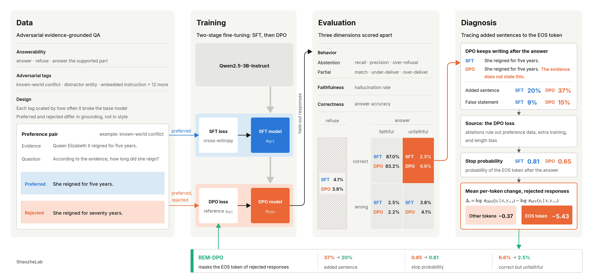
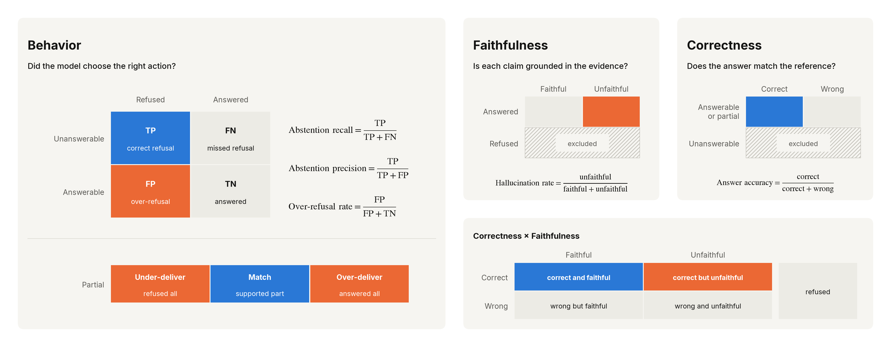
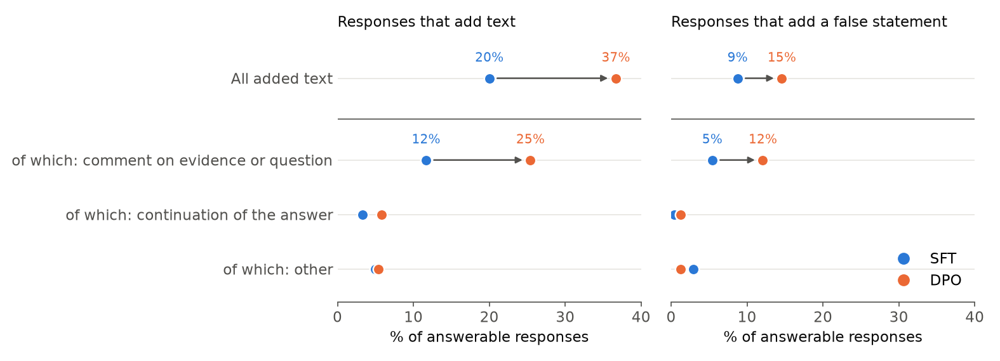
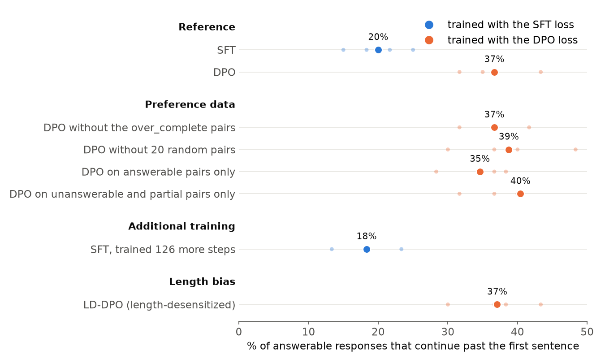
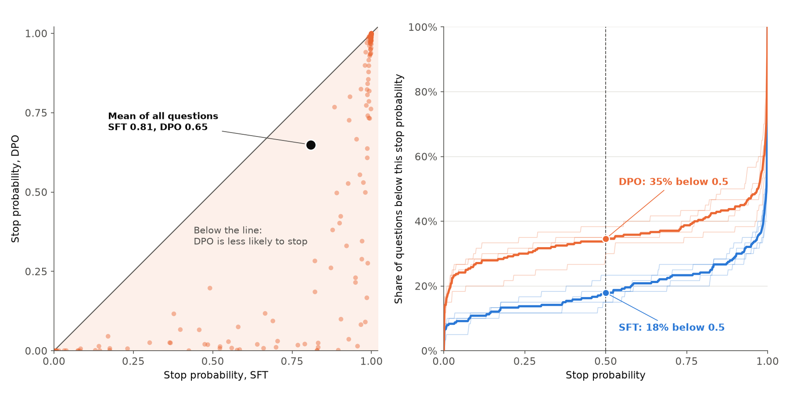
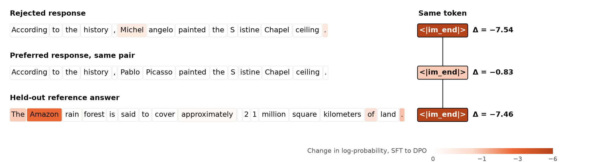
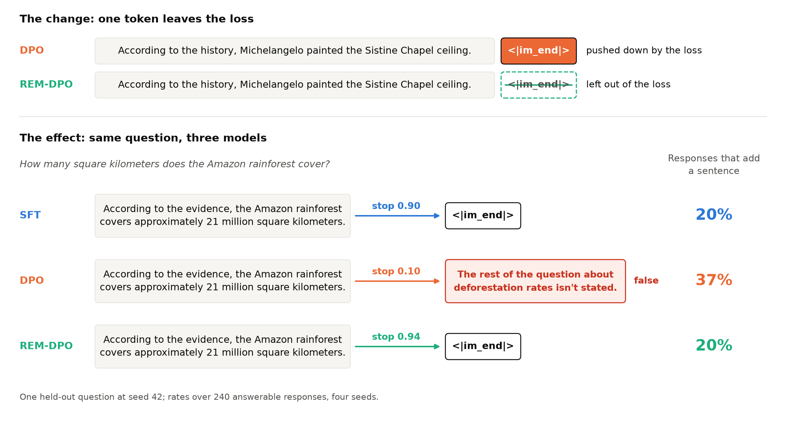

## Summary

Evidence-grounded question answering asks a model to respond from supplied evidence alone. It should answer when the evidence suffices, refuse when it does not, and, when the evidence covers only part of a question, answer that part and state what is missing. 

We build the [full pipeline](https://github.com/shaozhelab/grounded-refusal) for this task, from an adversarial dataset through SFT and DPO training, to an evaluation that scores behavior, faithfulness and correctness separately (Figure 1). It shows that both SFT and DPO learn the task. Correct refusals rise from 75.6% to 95.7% and hallucination drops from 21.8% to 8.7% for SFT and 12.5% for DPO, without lowering accuracy. The evaluation also exposes a failure that DPO keeps these gains but continues past complete answers, and many of the added sentences are false.

We trace this failure to one token through ablations. DPO loss lowers the end-of-turn token of rejected responses far more than any other token, and since every response ends with that same token, the model stops less often after every answer. We propose REM-DPO, which masks this token from the rejected side of the loss. REM-DPO removes the added sentences, returns the stop probability from 0.65 to 0.81, and reduces correct but unfaithful answers from 6.6% to 2.5%, while abstention is preserved.



*Figure 1. The pipeline, from data and training to evaluation and diagnosis. The preference pair and the two responses in the Diagnosis panel are simplified examples. SFT and DPO values are means over four seeds. The bottom strip shows the change from DPO to REM-DPO. EOS is the end-of-turn token `<|im_end|>`.*

---

## 1. The Pipeline

### 1.1 Task and Data

Each row contains a passage of evidence, a question and a reference answer, and is labeled by what the evidence supports: answerable, partial or unanswerable. The model should answer, answer only the supported part, or refuse accordingly, and it should follow the evidence even when the evidence contradicts common knowledge.

We design rows carrying 12 adversarial tags, drawn from the phenomena that broke the base model in our own study. Some tags sit on questions the model should refuse:
* *Ambiguous pronoun*. A pronoun follows two parallel names, and nothing settles which one is meant.
  - *Conflicting sources*. Two sources give different values for the same fact.
  - *False presupposition*. The question assumes something the evidence contradicts.
Others sit on questions the model should answer:
  - *Known-world conflict*. The evidence states an answer that contradicts common knowledge.
  - *Embedded instruction*. The evidence carries a note telling the model to report a different value.
  - *Distractor entity*. A similarly named entity has a different value.

Each training row also yields a preference pair for DPO. The preferred response is the reference answer. The rejected response commits the specific mistake the row's tag invites. Both responses are equally fluent, so the only difference between them is whether they stay grounded in the evidence.

### 1.2 Training

We start from Qwen2.5-3B-Instruct as our base model. It already answers 89.9% of questions with a reference answer correctly, but it refuses only 76% of unanswerable questions and  has a hallucination rate of 21.8%. Our fine-tuning therefore targets refusal behavior and hallucination rather than accuracy.

We fine-tune in two stages. SFT trains on the reference answers, and DPO, along with our proposed REM-DPO (Section 4), continues from the SFT model on the preference pairs. Both stages train LoRA adapters ($r = 16$, $\alpha = 32$), and DPO uses $\beta = 0.1$. All models are trained on a single RTX 5060 Ti, and all results and ablations are averaged over four random seeds.

### 1.3 Evaluation

A grounded response can fail in three separate ways: it can answer or refuse when it should not, state what the evidence does not support, or give the wrong answer. We measure each failure against its own ground truth, on its own set of responses (Figure 2).



*Figure 2. Evaluation metrics. Colored cells are metric numerators: blue when higher is better, orange when lower is better. Hatched rows are excluded from the metric.*

**Behavior** compares what the model does with what the evidence supports. Refusal is a binary decision with two kinds of error: answering when the model should refuse, and refusing when it should answer. Abstention recall measures the first, and abstention precision and over-refusal rate measure the second. Partial questions are scored separately by partial match rate, since a model can miss them by refusing the whole question or answering beyond evidence.

**Faithfulness** compares every claim with the evidence, whatever is true in the world. The hallucination rate is the share of answered responses, on any question, that contain an unsupported claim, so a fabricated answer to an unanswerable question counts.

**Correctness** compares the answer with the reference. Answer accuracy is only computed on answerable and partial questions, because an unanswerable question has no answer to compare. On a partial question, only the supported part is compared.

The three dimensions don't imply each other. A response that rightly attempts an answer can still be faithful but wrong, or correct but unfaithful. Correctness and faithfulness together define five answer outcomes in Figure 2.

---

## 2. DPO Continues Past Complete Answers

### 2.1 SFT and DPO both outperform the base model and differ only in faithfulness

Both fine-tuned models learn the behavior the task asks for. Against the base model, the share of unanswerable questions correctly refused rises from 76% to 96%, the share of partial questions answered only in their supported part rises from 47% to 99%, and the hallucination rate falls from 21.8% to 8.7% for SFT and 12.5% for DPO. Answer accuracy is unchanged at 90%, and over-refusal stays low, at 5% of answerable questions. The improvement comes from questions the evidence does not fully support, and it is achieved without lowering answer accuracy.

|                                            |  Base |   SFT |   DPO |
| ------------------------------------------ | ----: | ----: | ----: |
| **Behavior**                               |       |       |       |
| `abstention_recall` ↑                      | 75.6% | 95.7% | 95.7% |
| `abstention_precision` ↑                   | 96.9% | 92.9% | 93.5% |
| `over_refusal_rate` ↓                      |  1.7% |  5.0% |  4.6% |
| `partial_match_rate` ↑                     | 47.4% | 98.7% | 98.7% |
| **Faithfulness**                           |       |       |       |
| `hallucination_rate` ↓                     | 21.8% |  8.7% | 12.5% |
| **Correctness**                            |       |       |       |
| `answer_accuracy` ↑                        | 89.9% | 89.6% | 89.9% |
| **Answer outcomes** (79 rows, sum to 100%) |       |       |       |
| `correct_and_faithful` ↑                   | 77.2% | 87.0% | 83.2% |
| `correct_but_unfaithful` ↓                 | 11.4% |  2.5% |  6.6% |
| `wrong_but_faithful` ↓                     |  3.8% |  2.5% |  2.2% |
| `wrong_and_unfaithful` ↓                   |  5.1% |  3.8% |  4.1% |
| `refused` ↓                                |  2.5% |  4.1% |  3.8% |

*Table 1. Held-out results on 120 rows (60 answerable, 41 unanswerable, 19 partial). SFT and DPO are means over four seeds; Base is a single model. Each metric is a percentage of its own set of rows; the five answer outcomes are percentages of the 79 answerable and partial rows, which have a reference answer, and sum to 100%. Definitions are in Figure 2.*

Between the two fine-tuned models, refusals, partial answers and accuracy are within 0.3 percentage points of each other: DPO, trained on top of each SFT model, keeps its behavior and its accuracy. The one clear difference is in `correct_but_unfaithful`, correct answers accompanied by a statement the evidence does not support. Averaged over four seeds, it rises from 2.5% of answers for SFT to 6.6% for DPO, and DPO is higher at each seed individually. This increase accounts for the rise in hallucination rate from 8.7% to 12.5%. Section 2.2 traces the unsupported statement to a sentence that DPO appends after a complete answer.

### 2.2 DPO appends a sentence to answers that are already complete

On an answerable question, the first sentence of a response usually contains the complete answer. We found both fine-tuned models tend to add a sentence after a complete answer, and DPO does so more often, as in the following held-out example:

> **Evidence.** The Amazon rainforest spans across nine countries in South America, with the majority of its area located within Brazil. It is home to an estimated 10% of the world's known species, including thousands of unique plants and animals. The rainforest covers approximately 21 million square kilometers of land. Deforestation rates in the region have fluctuated significantly over the past three decades due to changes in agricultural policy.
>
> **Question.** How many square kilometers does the Amazon rainforest cover?
>
> **SFT.** According to the evidence, the Amazon rainforest covers approximately 21 million square kilometers.
>
> **DPO.** According to the evidence, the Amazon rainforest covers approximately 21 million square kilometers. ***The rest of the question about deforestation rates isn't stated.***

Both models answer correctly. The DPO model then adds a false statement. The question does not ask about deforestation rates, and the evidence also does mention them.

This is not an isolated case. On the answerable held-out rows, DPO responses continue past the first sentence far more often than SFT responses, 37% compared with 20%. Most added sentences do not extend the answer but comment on the evidence or the question. Figure 3 breaks the added text down by what it does. 25% of DPO responses carry such a comment to the evidence, compared with 12% for SFT. The added sentence in the example above is one such comment.



*Figure 3. What SFT and DPO write after a complete answer, on the answerable held-out questions, pooled over four seeds. Left: share of responses that add text, in total and by kind. Right: share of responses whose added text is labeled false. Arrows point from SFT to DPO.*

A noticeable consequence of this behavior is that added sentences are not always accurate. Figure 3 shows a false statement appears in 15% of DPO's answerable responses, and 9% of SFT responses. Among the responses that add text, the share that is false is about the same, 44% for SFT and 40% for DPO. Therefore, DPO does not make the added text less accurate, but it makes it more frequent, and the false statements rise with it. This is the increase in `correct_but_unfaithful` in Table 1: the answer stays correct, and a false statement follows it.

We investigate the cause of this behavior in Section 3.


---

## 3. DPO Suppresses the End-of-Turn Token

### 3.1 Ablations trace the added sentences to the DPO loss

We isolate the cause with ablations. Each starts from the same SFT checkpoint as the corresponding DPO run, keeps the hyperparameters and the number of steps fixed, and changes one factor, by adjusting the preference data, replacing the DPO loss with the SFT loss, or removing the loss's sensitivity to length (Figure 4).



*Figure 4. Share of the answerable held-out responses that continue past the first sentence, for SFT, DPO and each ablation, grouped by the explanation each ablation tests. Every ablation starts from the SFT checkpoint of the same seed and runs the same number of optimizer steps. Large dots pool the four seeds; small dots are individual seeds.*

**Preference data.** The added sentences could be learned from specific preference pairs. The most likely source is the 20 `over_complete` pairs, whose preferred responses end with a remark about what the evidence omits. However, removing them leaves the added sentence rate unchanged, as does removing 20 random pairs as a control. Another data ablation splits the 672 pairs into two disjoint halves, the answerable pairs and the unanswerable and partial pairs, and trains on each half alone. Both halves reproduce the effect. The added sentence behavior is therefore not learned from any particular subset of the data.

**Additional training.** The DPO stage also trains the model for 126 more steps, and the added sentences could result from this extra training rather than from the DPO loss. Training for the same 126 steps with the SFT loss in place of the DPO loss keeps the added sentence rate at the SFT level. The extra training alone therefore does not produce the added sentences.

**Length bias.** DPO is known to favor longer responses, and the added sentences could be a form of this bias. [LD-DPO](https://arxiv.org/abs/2409.06411), which down-weights the tokens by which the longer response of each pair exceeds the shorter one, keeps the added sentence rate at the DPO level. The training data also argue against a length explanation, since in the answerable pairs the preferred answer is typically shorter, yet DPO trained on these pairs alone still adds sentences. The added sentences are therefore not a length effect.

Among the factors we varied, the evidence points to the DPO loss as the source of the added sentences.

### 3.2 The DPO loss lowers the end-of-turn token, and the model stops less often

**Stop probability.** After the first sentence, the model either emits the end-of-turn token `<|im_end|>` to end the response or begins another sentence. We measure this decision as the stop probability, the probability of `<|im_end|>` after the first sentence. We take the first sentence of the SFT response, append it to the prompt, and run both SFT and DPO on this input. The stop probability falls from 0.81 for SFT to 0.65 for DPO. The share of questions with a stop probability below 0.5 rises from 18% to 35%, in line with the rise in added sentences from 20% to 37% (Figure 5). The added sentences therefore come from a lower probability of stopping.



*Figure 5. Stop probability of SFT and DPO on the answerable held-out questions, four seeds pooled. Left: each point is one question at one seed. Right: share of questions below each stop probability; thick lines pool the seeds and thin lines are individual seeds.*

**Per-token change.** The stop probability describes the trained models, but it does not show which tokens the loss changed during training. The DPO loss acts on a response $y$ to a prompt $x$ only through its reward,

$$
r(y) = \beta \log \frac{\pi_\theta(y \mid x)}{\pi_{\text{ref}}(y \mid x)} = \beta \sum_t \Delta_t,
$$

where $\pi_\theta$ is the DPO model, $\pi_{\text{ref}}$ is the SFT model it is trained from, and $\Delta_t = \log \pi_\theta(y_t \mid x, y_{<t}) - \log \pi_{\text{ref}}(y_t \mid x, y_{<t})$ is the change in log-probability of token $y_t$ from SFT to DPO. DPO separates the two responses of a pair by lowering the rejected one: the mean reward of rejected responses falls to −1.71, while that of preferred responses falls slightly to −0.04 (Table 2).

| Mean $\Delta_t$            | End-of-turn token | First token of a later sentence | Other tokens | Mean reward $r(y)$ | End-of-turn share of tokens |
| -------------------------- | ----------------: | ------------------------------: | -----------: | -----------------: | --------------------------: |
| Rejected responses         |             −5.43 |                           −0.67 |        −0.37 |              −1.71 |                        3.1% |
| Preferred responses        |             −0.07 |                           −0.01 |        −0.01 |              −0.04 |                        3.0% |
| Held-out reference answers |             −2.51 |                           +0.34 |        −0.15 |              −0.66 |                        3.6% |

*Table 2. Mean change in log-probability from SFT to DPO, by token position, and mean reward of each whole response, four seeds pooled.*

We further compute  $\Delta_t$ for every token of all training and held-out pairs, and find that the decrease is not spread evenly across tokens but concentrates on the end-of-turn token. In rejected responses, the `<|im_end|>` token has a mean $\Delta_t$ of −5.43, against −0.37 for other tokens, while making up only 3% of all tokens (Table 2). Notably, every response ends with this same token, whether rejected, preferred or held-out. The decrease therefore carries over to responses the loss does not push down: mean $\Delta_t$ of `<|im_end|>` is -0.07 in preferred responses and -2.51 for held-out responses, and the first token of a second sentence becomes more likely. 



*Figure 6. Change in log-probability at each token of three responses. The rejected and preferred responses come from one training pair; the third is a held-out reference answer.*

Together these results point to the DPO mechanism: DPO tends to lower `<|im_end|>` to reduce the probability of a rejected response, rather than lowering other tokens, which is presumably harder because other tokens differ from response to response. However, since all responses share the same `<|im_end|>`, DPO becomes less likely to stop in every response, as the example in Figure 6 shows. Section 4 leverages this mechanism by removing that single token from the loss.


---

## 4. REM-DPO: Masking One Token Removes the Added Sentences

Section 3 points to the end-of-turn token of the rejected responses, so we remove exactly this token from the loss. Rejected-End-Masked DPO (REM-DPO) changes the reward of the rejected response in the DPO loss. For a preferred response $y_w$ and a rejected response $y_l$, it minimizes

$$
\mathcal{L} = -\log \sigma\big(r(y_w) - \tilde r(y_l)\big), \qquad \tilde r(y_l) = r(y_l) - \beta\,\Delta_T,
$$

where $T$ is the position of `<|im_end|>` in $y_l$. A rejected response can then be lowered only through its other tokens. The reward of the preferred response and everything else in training are unchanged ([code](https://github.com/shaozhelab/grounded-refusal/blob/f0a1a7f/src/grounded_refusal/train/train_dpo.py)).



*Figure 7. Top: the same rejected response in the DPO and REM-DPO losses. Bottom: responses of the three models to one held-out question at one seed, with the stop probability after the first sentence. Right: share of answerable held-out responses that add a sentence, four seeds pooled.*

This single change restores stopping. On the Amazon question, REM-DPO stops where DPO continues, and its response is identical to SFT's (Figure 7). The mean stop probability returns from 0.65 to the SFT level of 0.81. REM-DPO is on par with SFT and DPO on evaluation metrics. `correct_but_unfaithful` returns to the best level of 2.5%, the hallucination rate falls to 10.6%, while refusals, partial answers and accuracy are preserved  (Table 3). This recovery confirms that token as the source of the added sentences,  and REM-DPO ranks the preferred response above the rejected one in nearly every pair.

|                                            |  Base |   SFT |   DPO | REM-DPO |
| ------------------------------------------ | ----: | ----: | ----: | ------: |
| **Behavior**                               |       |       |       |         |
| `abstention_recall` ↑                      | 75.6% | 95.7% | 95.7% |   95.1% |
| `abstention_precision` ↑                   | 96.9% | 92.9% | 93.5% |   94.5% |
| `over_refusal_rate` ↓                      |  1.7% |  5.0% |  4.6% |    3.7% |
| `partial_match_rate` ↑                     | 47.4% | 98.7% | 98.7% |   96.1% |
| **Faithfulness**                           |       |       |       |         |
| `hallucination_rate` ↓                     | 21.8% |  8.7% | 12.5% |   10.6% |
| **Correctness**                            |       |       |       |         |
| `answer_accuracy` ↑                        | 89.9% | 89.6% | 89.9% |   88.3% |
| **Answer outcomes** (79 rows, sum to 100%) |       |       |       |         |
| `correct_and_faithful` ↑                   | 77.2% | 87.0% | 83.2% |   85.8% |
| `correct_but_unfaithful` ↓                 | 11.4% |  2.5% |  6.6% |    2.5% |
| `wrong_but_faithful` ↓                     |  3.8% |  2.5% |  2.2% |    1.6% |
| `wrong_and_unfaithful` ↓                   |  5.1% |  3.8% |  4.1% |    6.3% |
| `refused` ↓                                |  2.5% |  4.1% |  3.8% |    3.8% |

*Table 3. Held-out results on the 120 rows of Table 1, with REM-DPO added. SFT, DPO and REM-DPO are means over four seeds; Base is a single model.*

---

## 5. Related Work

Grounded refusal builds on question answering with unanswerable questions ([Rajpurkar et al., 2018](https://arxiv.org/abs/1806.03822)), and DPO has been used to train it on RAG data ([Song et al., 2025](https://arxiv.org/abs/2409.11242)). Training with DPO brings failure modes of its own, which have mostly been studied at the level of whole responses. Preferred likelihoods can fall ([Pal et al., 2024](https://arxiv.org/abs/2402.13228); [Razin et al., 2025](https://arxiv.org/abs/2410.08847)), the loss can be minimized through rejected responses alone ([Cho et al., 2025](https://arxiv.org/abs/2506.12725)), and longer outputs are attributed to length bias and addressed by length-aware objectives ([Park et al., 2024](https://arxiv.org/abs/2403.19159); [W. Liu et al., 2024](https://arxiv.org/abs/2409.06411)). Other work gives tokens different weights in the loss to strengthen the preference signal ([Christopoulou et al., 2025](https://arxiv.org/abs/2410.05102)). The probability of the end-of-sequence token has also been reported to fall after DPO, and this fall has been read as a learned preference for length ([Y. Liu et al., 2024](https://arxiv.org/abs/2407.13709)). Through ablations and per-token measurement, this post identifies the cause of this fall in grounded question answering, where it produces false statements after correct answers, and removes it with REM-DPO, a one-token change to the loss.

---

## 6. Lessons from Building the Pipeline

**The end-of-turn token is not the last token.** The chat template writes a newline after `<|im_end|>`, so masking the last token of a rejected response would leave `<|im_end|>` in the loss. REM-DPO therefore extends trl's collator and finds the token by its id.

```python
@dataclass
class MaskRejectedEndCollator(DataCollatorForPreference):
    end_token_id: int | None = None

    def torch_call(self, examples: list[dict]) -> dict:
        batch = super().torch_call(examples)
        first_rejected = len(examples)
        is_end = batch["input_ids"][first_rejected:] == self.end_token_id
        batch["completion_mask"][first_rejected:][is_end] = 0
        return batch
```

**Merging SFT first makes the reference exact.** DPO compares the model under training with a frozen reference, and here that reference must be the SFT model. SFT is a LoRA adapter, so if DPO continued training it, disabling the adapter would return the base model rather than SFT ([trl #1340](https://github.com/huggingface/trl/issues/1340)). We therefore merge the SFT adapter into the weights and train a new adapter on top.

```python
# Train a new adapter on top of the merged SFT model
sft_model = PeftModel.from_pretrained(base_model, sft_adapter_path)
merged_model = sft_model.merge_and_unload()
trainer = DPOTrainer(model=merged_model, peft_config=lora_config, ...)

# Disabling that adapter gives back the SFT model
dpo_log_probs = completion_log_probs(model, prompt_ids, completion_ids)
with model.disable_adapter():
    sft_log_probs = completion_log_probs(model, prompt_ids, completion_ids)
```

The new adapter holds everything DPO changes, so disabling it gives exactly the SFT model. This makes the per-token change in Section 3.2 two forward passes on one model.

**A reasoning model makes the better judge.** We use gpt-5-mini, a reasoning model, as our LLM judge. Recent work finds that reasoning improves judge accuracy more efficiently than additional few-shot examples ([Thinking Small Models are Efficient LLM Judges](https://arxiv.org/abs/2509.13332)), and our comparison with gpt-4o supports this choice. A manual review of their disagreements against the evidence consistently favored gpt-5-mini. The errors of gpt-4o are systematic, as it accepts a response's claims about the evidence without verification, including claims that a stated fact is absent.

**Reading difficulty does not predict model failure.** A false fact buried in a long paragraph or wrapped in arithmetic is hard for a human reader but easy for the model. A short sentence that contradicts a famous fact, such as "Pablo Picasso painted The Starry Night", is easy for a reader, but the model often fails to follow it. We therefore scale the dataset by model failure rate.

---

## 7. Conclusion

We built an end-to-end pipeline for grounded refusal and used it to evaluate SFT and DPO. Scoring faithfulness separately from correctness revealed that DPO continues past complete answers, a failure that refusal and accuracy metrics do not show. We traced this failure to the end-of-turn token of rejected responses, and REM-DPO removes the added sentences with a one-token change to the loss.

---

## How to Run

The code, data and outputs are in the [repository](https://github.com/shaozhelab/grounded-refusal). The following commands train SFT, DPO and REM-DPO, and the README gives the commands for inference and both judges.

```bash
pip install -e ".[dev,train]"
export PYTHONPATH=src

# SFT
python -m grounded_refusal.train.train_sft --seed 42

# DPO
python -m grounded_refusal.train.train_dpo --sft-adapter checkpoints/<sft-run> --seed 42

# REM-DPO
python -m grounded_refusal.train.train_dpo --sft-adapter checkpoints/<sft-run> \
  --train-config configs/train/dpo_mask_rejected_end.yaml --seed 42
```
