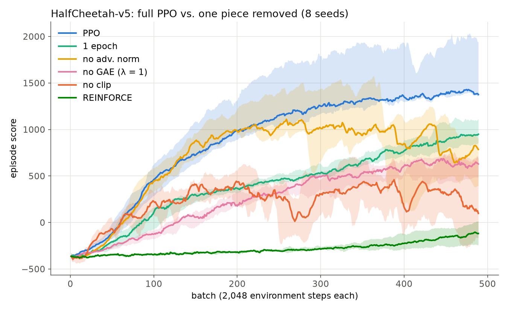
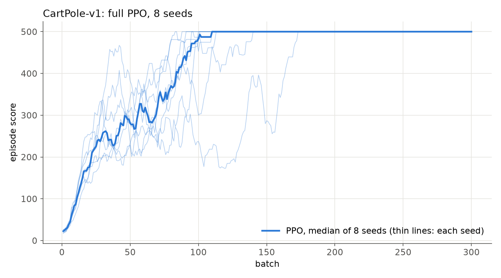
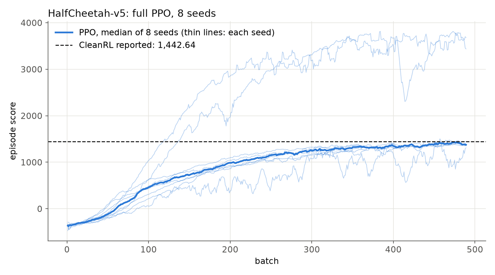
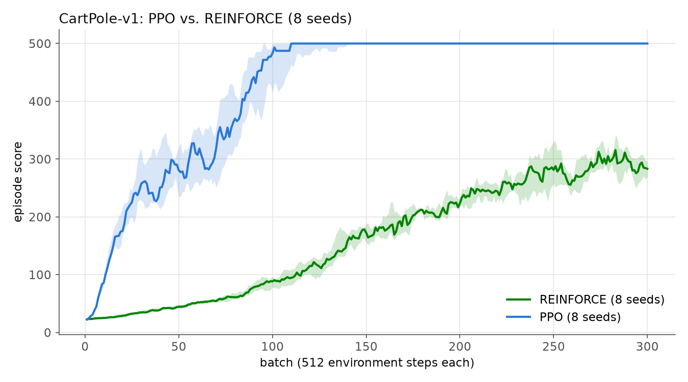
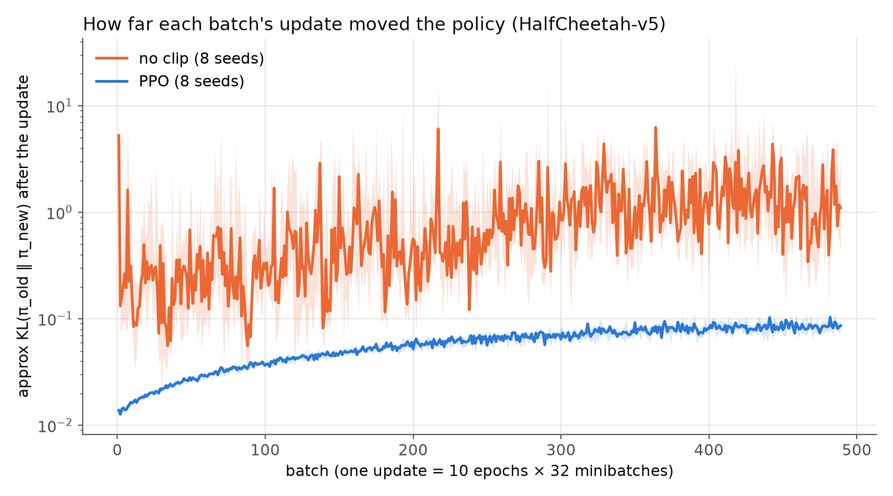
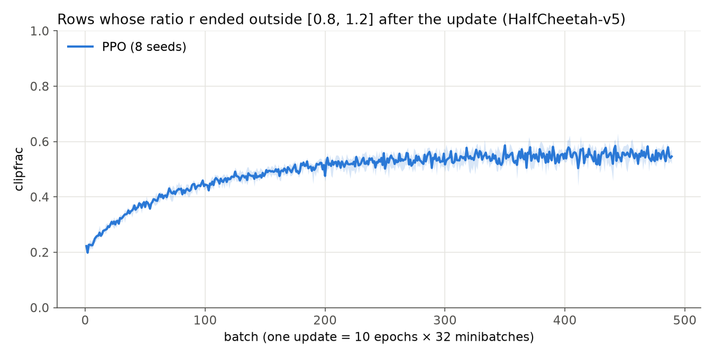
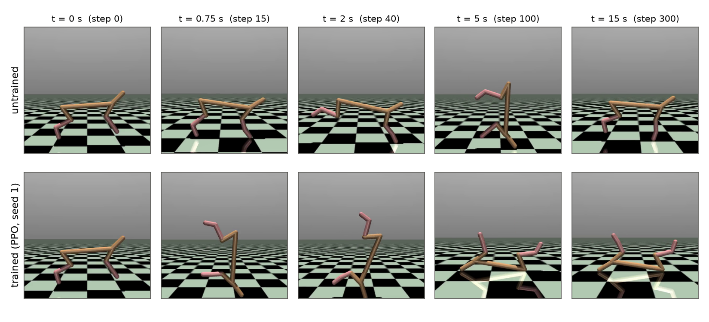

## Summary

We implemented Proximal Policy Optimization as [nanoPO](https://github.com/shaozhelab/nanoPO), with the goal of understanding each component of the algorithm through measurement. We evaluated it on CartPole-v1 and HalfCheetah-v5 with eight seeds per configuration. On HalfCheetah the median final score over the eight seeds is 1401.9, on par with the 1442.64 reported by CleanRL; on CartPole all eight seeds reach the maximum score of 500 and hold it for the remainder of training.

An ablation study, removing one component at a time, shows that each of the four components contributes: removing clipping, GAE, advantage normalization or the repeated epochs each lowers the median score. Clipping contributes the most, and removing it lowers the median by 90%. REINFORCE, obtained from the same code by changing three settings, ends at a median of −120.8, against 1401.9 for PPO.

To examine how clipping limits each update, we logged two quantities after every update: the approximate KL divergence between the policy before and after the update, and the fraction of samples whose probability ratio lies outside the clip range $[0.8, 1.2]$. Although PPO's objective contains no KL term, clipping keeps 98% of updates within a KL of 0.014 to 0.13. Without clipping, the KL spans more than three orders of magnitude, and large updates are followed by collapses in score. At the same time, about half the ratios end the update outside the clip range, but they stay close to it, at about $r \approx 1.6$ on average. Clipping therefore limits how far the ratios move rather than confining them to the range.

We also report three lessons from the implementation and relate each finding to its counterpart in LLM post-training.


*PPO and five ablations on HalfCheetah-v5. Each line is the median over eight seeds and each band the 25th–75th percentile, after a 10-batch moving average. PPO leads through the second half of training and finishes highest.*

## 1. Implementation and experimental design

We implemented PPO as nanoPO, a single file, [`ppo/ppo.py`](https://github.com/shaozhelab/nanoPO/blob/f45acd5/ppo/ppo.py). nanoPO is configuration-driven. The hyperparameters of each environment are stored in [`DEFAULTS`](https://github.com/shaozhelab/nanoPO/blob/f45acd5/ppo/ppo.py#L39-L46), and each experiment is a named set of changes to them in [`EXPERIMENTS`](https://github.com/shaozhelab/nanoPO/blob/f45acd5/ppo/ppo.py#L48-L57), selected with [`--exp`](https://github.com/shaozhelab/nanoPO/blob/f45acd5/ppo/ppo.py#L323). This design streamlines the ablation studies in Section 3. All results are aggregated over eight random seeds and reported as the median and percentile range, with the final score of each run measured as the mean episode score over its last 20 batches.

```python
EXPERIMENTS = {
    "ppo": dict(),                       # full PPO
    "no-adv-norm": dict(adv_norm=False),
    "no-gae": dict(lam=1.0),             # Monte Carlo return minus V(s)
    "no-clip": dict(clip=1e9),           # the ratio never reaches the clip range
    "1-epoch": dict(epochs=1),
    # one gradient step per batch on fresh data: ratio = 1, so the update is REINFORCE with a value baseline
    "reinforce": dict(lam=1.0, epochs=1, minibatch_size=0),
}
```
*Source: [`ppo/ppo.py`, lines 48–57](https://github.com/shaozhelab/nanoPO/blob/f45acd5/ppo/ppo.py#L48-L57)*

The last configuration reduces PPO to REINFORCE. With a single gradient step on the whole batch, the gradient is taken before the policy has moved, so $r = 1$, the clip is inactive, and $\nabla_\theta r = \nabla_\theta \log \pi_\theta(a\mid s)$. The update is then $\nabla_\theta \log \pi_\theta(a\mid s) \cdot A$, the REINFORCE gradient with a learned baseline. Because the two algorithms share every other line of code, the difference between them measures exactly what PPO adds.

## 2. Reproducing the published results

nanoPO reaches the maximum score on CartPole-v1 in every seed and matches the published PPO result on HalfCheetah-v5. 

**CartPole-v1 (300 batches of 512 steps).** All eight seeds reach the maximum score of 500 and hold it for the rest of training. The table lists, for each seed, the first batch that scores 500 and the batch from which every later batch scores 500.

| Seed                     |     1 |     2 |     3 |     4 |     5 |     6 |     7 |     8 |
| ------------------------ | ----: | ----: | ----: | ----: | ----: | ----: | ----: | ----: |
| First batch at 500       |    40 |    39 |    55 |    21 |    22 |    69 |    15 |    73 |
| Stable at 500 from batch |    92 |   101 |    79 |    82 |   133 |    91 |   104 |   164 |
| Final score              | 500.0 | 500.0 | 500.0 | 500.0 | 500.0 | 500.0 | 500.0 | 500.0 |


*nanoPO PPO on CartPole-v1: each of the eight seeds (thin lines) and their median (thick line).*

**HalfCheetah-v5 (489 batches of 2048 steps, 1,001,472 steps in total).** The median final score over the eight seeds is 1401.9, on par with the 1442.64 ± 46.03 reported by CleanRL. Six seeds score between 1154.7 and 1432.3. Seeds 5 and 6 converge to a faster gait and score 3707.2 and 3613.9.

| Seed        |       1 |       2 |       3 |       4 |       5 |       6 |       7 |       8 |  Median |
| ----------- | ------: | ------: | ------: | ------: | ------: | ------: | ------: | ------: | ------: |
| Final score | 1411.8 | 1363.0 | 1432.3 | 1391.9 | 3707.2 | 3613.9 | 1392.0 | 1154.7 | 1401.9 |


*nanoPO PPO on HalfCheetah-v5: each of the eight seeds (thin lines), their median (thick line) and the score reported by CleanRL (dashed).*

**Determinism.** [`train`](https://github.com/shaozhelab/nanoPO/blob/f45acd5/ppo/ppo.py#L239-L253) seeds NumPy, PyTorch and the environment from `--seed`. A rerun with the same seed reproduces the score of every batch and diagnostic metrics exactly. Every number in this post can therefore be regenerated from the repository.

## 3. Ablation study: the contribution of each component

### From REINFORCE to PPO
PPO differs from REINFORCE in two respects. It estimates the advantage with lower variance, through GAE and advantage normalization. It also reuses each batch for many gradient steps, through minibatches and repeated epochs, and clipping keeps this reuse stable by limiting the KL divergence of each update (Section 4). 

**HalfCheetah-v5.** We show the performance moving from REINFORCE to PPO on HalfCheetah in two steps, over eight seeds each.

|           | Gradient steps per batch | Change                             | Final score (mean) | Final score (median) |
| --------- | -----------------------: | ---------------------------------- | ------: | ------: |
| REINFORCE |                        1 | One step on the whole batch        |  −116.1 |  −120.8 |
| 1 epoch   |                       32 | GAE and 32 clipped minibatch steps | 1060.1 |   942.5 |
| PPO       |                      320 | Ten passes over the batch          | 1933.4 | 1401.9 |

With the same 2048 steps of rollout batch, PPO supports 320 gradient steps, and the median score rises from −120.8 to 1401.9. Most of the gain comes from the first step, which adds GAE and 32 clipped minibatch steps and raises the median to 942.5. The ten passes over each batch then add a further 459.4. PPO's advantage over REINFORCE therefore lies in how much learning it extracts from each batch of experience.

**CartPole-v1.** The comparison with REINFORCE holds on CartPole over eight seeds each.

|           | Gradient steps per batch | First batch at 500 | Final score (mean) | Final score (median) |
| --------- | -----------------------: | -----------------: | ----: | -----: |
| REINFORCE |                        1 |            173–245 | 290.5 |  284.4 |
| PPO       |                       80 |              15–73 | 500.0 |  500.0 |

PPO reaches 500 about five times sooner than REINFORCE, at a median of batch 39.5 against 202.5, and holds it in every seed, while REINFORCE falls back to a median final score of 284.4. Over 300 batches PPO takes 24000 gradient steps (10 epochs × 8 minibatches per batch) and REINFORCE takes 300, on identical data.


*PPO and REINFORCE on CartPole-v1. Each line is the median over eight seeds and each band the 25th–75th percentile, after a 10-batch moving average.*

### Removing one PPO component at a time
The table shows performance of removing one component at a time from PPO. All lower the median score. Per-seed detailed values are listed in the [appendix](#appendix-per-seed-scores). 

| Configuration              | Final score (mean) | Final score (median) |
| -------------------------- | ------: | ------: |
| PPO                        | 1933.4 | 1401.9 |
| 1 epoch                    | 1060.1 |   942.5 |
| No advantage normalization |   870.6 |   772.9 |
| No GAE ($\lambda = 1$)     |   636.6 |   630.3 |
| No clipping                |   358.6 |   137.7 |
| REINFORCE                  |  −116.1 |  −120.8 |


*PPO and five ablations on HalfCheetah-v5. Each line is the median over eight seeds and each band the 25th–75th percentile, after a 10-batch moving average. PPO leads through the second half of training and finishes highest.*

Each ablation affects training in a distinct way.
- **No clipping** gives the lowest median of the four single-component ablations, 137.7, and the least stable training. Seed 3 reaches 778.3 at batch 100 and falls to −303.8 by batch 250. Section 4 measures the cause.
- **No advantage normalization** follows PPO for about 200 batches and then degrades. Seed 2 peaks at 1103.8 at batch 219 and ends at 123.3.
- **No GAE** learns slowly from the start. At batch 100 all eight seeds have negative scores, from −63.9 to −261.7, while all eight PPO seeds have positive scores, from 20.3 to 1077.7. The Monte Carlo advantage has higher variance than the GAE estimate, which slows learning from the first batches.
- **1 epoch** trains steadily but more slowly. Using each batch once gives a median of 942.5, and using it ten times raises the median to 1401.9.

Clipping contributes the most. Without it the median falls from 1401.9 to 137.7, a drop of 90%. Removing GAE lowers the median by 55%, removing advantage normalization by 45%, and using each batch once by 33%. Clipping matters most because the 320 gradient steps per batch depend on it, and Section 4 measures how.

## 4. How clipping limits each update

Clipping is designed to keep each PPO update close to the policy that collected the data, so that several epochs over the same batch do not move the policy too far. Section 3 shows that PPO depends on it more than on any other component, as removing clipping lowers the median score by 90%. To examine how clipping limits each update, we measure two quantities after the last gradient step of every update, so that both reflect the cumulative effect of all 320 steps. The approximate KL measures how far the policy moved, and the clip fraction measures how many samples ended outside the clip range.

### Two quantities: approximate KL and clip fraction

For each stored sample, let $r = \pi_{\text{new}}(a\mid s) / \pi_{\text{old}}(a\mid s)$, where $\pi_{\text{old}}$ is the policy that collected the batch and $\pi_{\text{new}}$ is the policy after the update. Because the samples were drawn from $\pi_{\text{old}}$,

$$
\mathrm{KL}(\pi_{\text{old}} \,\|\, \pi_{\text{new}})
= \mathbb{E}_{a\sim\pi_{\text{old}}}\left[-\log r\right]
= \mathbb{E}_{a\sim\pi_{\text{old}}}\left[(r-1)-\log r\right],
$$

where the second equality holds because $\mathbb{E}_{\pi_{\text{old}}}[r] = \sum_a \pi_{\text{new}}(a\mid s) = 1$. The added term $r - 1$ has zero mean, so the estimate stays unbiased, and it makes each term $f(r) = (r-1) - \log r$ non-negative, zero at $r = 1$ and increasing as $r$ moves away from 1. The batch average of $f(r)$ is the *approximate KL* ([Schulman, 2020](http://joschu.net/blog/kl-approx.html)), which has lower variance than the batch average of $-\log r$.

The *clip fraction* is the fraction of samples whose ratio lies outside the clip range $[1-\epsilon, 1+\epsilon]$, with $\epsilon = 0.2$,

$$
\text{clip fraction} = \frac{1}{N}\sum_{i=1}^{N} \mathbb{1}\left[\,|r_i - 1| > \epsilon\,\right],
$$

where $N$ is the number of samples in a batch (2048 on HalfCheetah). If clipping held every ratio inside the range, the clip fraction would be zero. Both quantities are computed in one pass over the batch after the update.

```python
# after the last step: how far the whole update moved the policy on this batch
with torch.no_grad():
    log_ratio = agent.distribution(obs).log_prob(actions) - old_logprobs
    ratio = torch.exp(log_ratio)
    approx_kl = ((ratio - 1) - log_ratio).mean().item()
    clipfrac = ((ratio - 1).abs() > cfg.clip).float().mean().item()
```
*Source: [`ppo/ppo.py`, lines 226–231](https://github.com/shaozhelab/nanoPO/blob/f45acd5/ppo/ppo.py#L226-L231)*

### Clipping bounds the KL without a KL constraint


*Approximate KL after each update, PPO and no clipping, eight seeds each (median and 25th–75th percentile, log scale).*

We apply the approximate KL to the clipping ablation of Section 3 to measure how far each update moves the policy with and without clipping. The measurement shows that, although PPO's objective contains no KL term, clipping keeps the KL tightly controlled. With clipping, the median KL of each seed lies between 0.051 and 0.070, and 98% of all updates have a KL between 0.014 and 0.13, within one order of magnitude across seeds and throughout training. Without clipping, the per-seed medians are ten times larger, at 0.487 to 0.884, the central 98% of updates spans 0.012 to 37, more than three orders of magnitude, and 185 updates exceed a KL of 10. Clipping therefore acts as an implicit trust region that the objective never states.

Without this control, large updates are followed by collapses in score. For example, in no-clipping seed 4, an update with a KL of 3.131 at batch 269 drops the score from 1948.2 to 319.7 in the next batch. Such collapses are not isolated, and generally, among no-clipping updates from a score above 500, the score falls by more than half after 16% of updates with a KL above 10, compared with 2% of those with a KL below 0.1. This aligns with the ablation in the original PPO paper, where clipped is higher than unclipped averaged over its seven MuJoCo tasks. Controlling the KL is therefore what keeps ten epochs over the same batch stable, and losing it accounts for the largest drop in final score among the ablations in Section 3.

### About half the ratios end outside the clip range


*Fraction of samples whose ratio lies outside [0.8, 1.2] at the end of each update, PPO, eight seeds (median and 25th–75th percentile).*

We found clip fraction at 0.55, indicating that, at the end of a typical update, about half of the samples have ratios outside $[0.8, 1.2]$. This is expected from how the clipped objective works. Even if the gradient of a sample is zero given clipping, it can still move out of range being pushed by the aggregated gradient of samples still in the range.

The KL limits how far these ratios can move. Attributing the entire approximate KL to the samples outside the range gives an upper bound on their average deviation,

$$
\overline{f(r)}_{\text{outside}} \;\le\; \frac{\text{approx KL}}{\text{clip fraction}},
$$

with $f(r) = (r-1) - \log r$ as defined above. Once the clip fraction settles (batches 201–489), this bound has a median of 0.135, which corresponds to $r \approx 1.6$, compared with $r \approx 2.5$ without clipping. Clipping therefore does not confine the ratios to the range, but keeps those that leave it close to the boundary.

## 5. Lessons from the implementation

Three details decided whether the implementation trained correctly.

**Terminated and truncated episodes.** Gymnasium distinguishes two ways an episode can end. An episode is terminated when it reaches a terminal state, after which no further reward is possible. It is truncated when it reaches the time limit, although the agent could have continued to collect reward. HalfCheetah has no terminal state, so every episode is truncated at 1000 steps. The TD error must therefore bootstrap from $V(s_{t+1})$ at a truncation and set it to zero only at a termination. nanoPO computes this value as each step is collected:

```python
next_value = 0.0 if terminated else agent.value_of(next_obs)
```
*Source: [`ppo/ppo.py`, line 265](https://github.com/shaozhelab/nanoPO/blob/f45acd5/ppo/ppo.py#L265)*

The value is computed during collection because the environment resets at the end of an episode, after which $s_{t+1}$ is no longer available. Storing it with each step gives every TD error the same form, $\delta_t = r_t + \gamma V(s_{t+1}) - V(s_t)$, regardless of how the episode ended. Treating truncation as termination would train the value network to predict a future return of zero every 1000 steps.

**Exact log-probabilities under action clipping.** A Gaussian policy has unbounded support, however continuous-control environments accept actions only within fixed bounds, for example, HalfCheetah-v5 accepts only [-1, 1]. Each sampled action must therefore be mapped into the bounds before it reaches the environment, and noticeably, where this mapping is applied critically determines whether the PPO ratio is exact, because the ratio compares $\pi_\theta$ and $\pi_{\text{old}}$ at the action the policy sampled. If the agent clips the action and stores the clipped value, the log-probabilities in the ratio no longer refer to that action, and the ratio is biased. In our implementation, nanoPO applies the clipping inside the environment with [`ClipAction`](https://github.com/shaozhelab/nanoPO/blob/f45acd5/ppo/ppo.py#L243-L246). The agent and the buffer see only the sampled action, clipping becomes part of the environment dynamics, and the ratio is computed exactly and thus not biased.

One added note is that Soft Actor-Critic (SAC) takes a different approach and passes each Gaussian sample through tanh, so actions never leave the bounds. The policy is then no longer Gaussian, and its log-probability requires a correction term for the transform. Our implementation keeps the Gaussian policy and needs no such correction.

**The policy optimizes the reward as written.** A reward function specifies the intended behavior only indirectly, and the policy optimizes the function rather than the intent. HalfCheetah illustrates this. Its reward is the forward velocity minus a control cost proportional to the squared torques, with no term for the body's orientation, and the episode does not end when the cheetah flips over. A policy can therefore score well while running upside down. The trained seed-1 policy flips onto its back by step 15 and runs inverted for 982 of its 1000 steps, covering 91.8 m for a score of 1479.9 (forward reward 1836.7, control cost −356.7). This is a valid solution under the reward as specified, and it is visible in the rollout but not in the score. For reference, the untrained policy stays upright but drifts 4.9 m backward and scores −410.8.

This is interesting to call out because learned reward models in LLM post-training face the same pressure. The policy maximizes the reward model's score, including through behaviors the human raters did not intend, such as longer responses.


*The untrained policy (top) and the trained seed-1 policy (bottom) at the same moments. The trained policy flips at step 15 and runs on its back.*

## 6. Correspondence with LLM post-training

In LLM post-training, an episode is a generated response, each token is an action, and the reward comes from a reward model or a verifier. Each finding in the post has a direct consequence in this setting.

| Finding in this post | Consequence for LLM post-training |
|---|---|
| Clipping bounds the per-update KL without a KL term (Section 4) | PPO for LLMs also penalizes the KL to a frozen reference model, which limits drift over the whole of training. The per-update KL to $\pi_{\text{old}}$ is a separate quantity, and clipping is what bounds it. |
| Ratios leave the clip range but stay close to it (Section 4) | A clip fraction near 0.5 is not by itself a sign of instability. The approximate KL, read together with the clip fraction, shows how far each update moves the policy. |
| Ten epochs over each batch raise the median score by 459.4 over one epoch (Section 3) | Generating responses dominates the cost of LLM RL, so reusing each batch for several gradient steps matters more, and clipping is what makes this reuse safe. |
| Truncation is not termination (Section 5) | A response cut off at the maximum length is truncated, not finished, and scoring it as a complete answer introduces the same bias. |
| The ratio must use the log-probability of the sampled action (Section 5) | When rollouts come from a separate inference engine, its log-probabilities can differ numerically from the trainer's, and the ratio is no longer exact. |

## How to run

```bash
git clone https://github.com/shaozhelab/nanoPO && cd nanoPO
python -m ppo.ppo --env-id CartPole-v1 --seed 1
python -m ppo.ppo --env-id HalfCheetah-v5 --seed 1
python -m ppo.ppo --env-id HalfCheetah-v5 --seed 1 --exp no-clip   # any experiment from EXPERIMENTS
```

Each run writes its per-batch score, approximate KL and clip fraction to [`results/{env}/{exp}/seed{n}.csv`](https://github.com/shaozhelab/nanoPO/blob/f45acd5/ppo/ppo.py#L288-L294).

## References

- Schulman, Wolski, Dhariwal, Radford, Klimov. *Proximal Policy Optimization Algorithms.* 2017. [arXiv:1707.06347](https://arxiv.org/abs/1707.06347)
- Schulman, Moritz, Levine, Jordan, Abbeel. *High-Dimensional Continuous Control Using Generalized Advantage Estimation.* ICLR 2016. [arXiv:1506.02438](https://arxiv.org/abs/1506.02438)
- Williams. *Simple Statistical Gradient-Following Algorithms for Connectionist Reinforcement Learning.* Machine Learning, 1992.
- Huang, Dossa, Ye, Braga, Chakraborty, Mehta, Araújo. *CleanRL: High-quality Single-file Implementations of Deep Reinforcement Learning Algorithms.* JMLR 2022.
- Huang, Dossa, Raffin, Kanervisto, Wang. *The 37 Implementation Details of Proximal Policy Optimization.* ICLR Blog Track, 2022.
- Engstrom, Ilyas, Santurkar, Tsipras, Janoos, Rudolph, Madry. *Implementation Matters in Deep Policy Gradients: A Case Study on PPO and TRPO.* ICLR 2020. [arXiv:2005.12729](https://arxiv.org/abs/2005.12729)
- Andrychowicz et al. *What Matters in On-Policy Reinforcement Learning? A Large-Scale Empirical Study.* ICLR 2021.
- Schulman. *Approximating KL Divergence.* 2020. [joschu.net/blog/kl-approx.html](http://joschu.net/blog/kl-approx.html)
- Shao et al. *DeepSeekMath: Pushing the Limits of Mathematical Reasoning in Open Language Models* (introduces GRPO). 2024. [arXiv:2402.03300](https://arxiv.org/abs/2402.03300)
- Haarnoja, Zhou, Abbeel, Levine. *Soft Actor-Critic: Off-Policy Maximum Entropy Deep Reinforcement Learning with a Stochastic Actor.* ICML 2018. [arXiv:1801.01290](https://arxiv.org/abs/1801.01290)
- Towers et al. *Gymnasium: A Standard Interface for Reinforcement Learning Environments.* 2024. [arXiv:2407.17032](https://arxiv.org/abs/2407.17032)
- Todorov, Erez, Tassa. *MuJoCo: A Physics Engine for Model-Based Control.* IROS 2012.
- von Werra et al. *TRL: Transformer Reinforcement Learning.* 2020. [github.com/huggingface/trl](https://github.com/huggingface/trl)
- Sheng et al. *HybridFlow: A Flexible and Efficient RLHF Framework* (verl). EuroSys 2025. [arXiv:2409.19256](https://arxiv.org/abs/2409.19256)

## Appendix: per-seed scores

HalfCheetah-v5, mean score over the last 20 batches of each seed.

| Configuration              |       1 |       2 |       3 |       4 |       5 |       6 |       7 |       8 | Final score (mean) | Final score (median) |
| -------------------------- | ------: | ------: | ------: | ------: | ------: | ------: | ------: | ------: | ------: | ------: |
| PPO                        | 1411.8 | 1363.0 | 1432.3 | 1391.9 | 3707.2 | 3613.9 | 1392.0 | 1154.7 | 1933.4 | 1401.9 |
| 1 epoch                    |   869.1 |   881.7 | 1074.3 | 2017.3 |   761.3 | 1204.3 |   669.8 | 1003.3 | 1060.1 |   942.5 |
| No advantage normalization |   695.0 |   123.3 |   923.3 |   850.7 | 1036.3 |   478.5 |   273.4 | 2583.9 |   870.6 |   772.9 |
| No GAE                     |   516.5 | 1484.6 |   357.0 |   638.4 |    95.5 |   622.2 |   657.8 |   720.9 |   636.6 |   630.3 |
| No clipping                |   138.8 |   544.2 | 1055.4 | 2011.0 |  −173.5 |  −512.7 |   136.7 |  −330.7 |   358.6 |   137.7 |
| REINFORCE                  |  −249.5 |  −245.6 |    48.5 |    −1.3 |   −41.0 |  −200.6 |  −240.2 |     0.8 |  −116.1 |  −120.8 |
